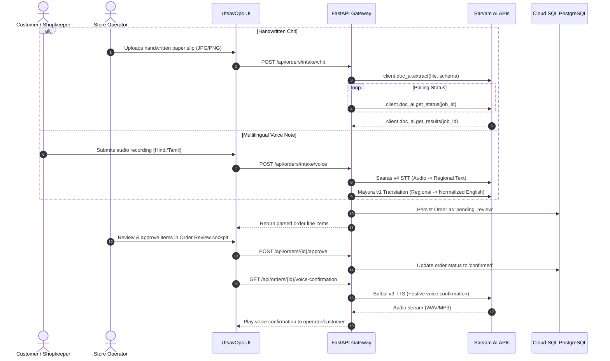
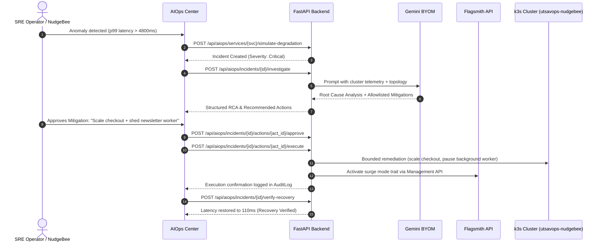

# UtsavOps — Complete Architecture Diagram

## 1. End-to-End System Architecture

```mermaid
flowchart TD
    subgraph Client ["Client Layer (Browser / Mobile)"]
        UI["React 19 Frontend<br/>(Vite 6 + TailwindCSS v4)"]
        AuthCtx["Auth Context & Token Storage"]
        Badge["ProviderBadges (Live / Simulated / Fallback)"]
    end

    subgraph Gateway ["Application Gateway (FastAPI)"]
        RouterAuth["/api/auth (JWT + Rate Limit + Blacklist)"]
        RouterOrders["/api/orders (Intake, Voice, Review)"]
        RouterFlags["/api/flags (Surge Mode & Segments)"]
        RouterDispatch["/api/dispatch (Address, Geocode, AQI)"]
        RouterAIOps["/api/aiops (NudgeBee & Incident SRE)"]
        RouterAudit["/api/audit (Immutable Audit Trail)"]
    end

    subgraph AuthLayer ["Security & RBAC"]
        AuthSecret["AUTH_SECRET_KEY (HMAC-SHA256)"]
        RateLimiter["Sliding Window Rate Limiter (5 / 5 min)"]
        TokenBlacklist["Token Revocation Cache & DB"]
    end

    subgraph Sponsors ["Sponsor & Cloud Integrations"]
        subgraph SarvamAI ["Sarvam AI Suite"]
            DocAI["Document AI (Async SDK Chit OCR)"]
            Saaras["Saaras v4 (Multilingual STT)"]
            Mayura["Mayura v1 (Catalog Translation)"]
            Bulbul["Bulbul v3 (Multilingual Voice TTS)"]
        end

        subgraph FlagsmithService ["Flagsmith Service"]
            FlagsEdge["Flagsmith Edge API (Flags & Traits)"]
            FlagsMgmt["Flagsmith Management API (Remote Patch)"]
        end

        subgraph GoogleCloud ["Google Cloud APIs"]
            AddrVal["Address Validation API"]
            Geocoding["Geocoding API"]
            AQI["Air Quality API"]
        end

        subgraph BYOM ["AI AIOps & BYOM"]
            Gemini["Gemini BYOM (gemini-flash-latest RCA)"]
            NudgeBeeSvc["NudgeBee Telemetry & VM Metadata"]
        end
    end

    subgraph Storage ["Authoritative Data Layer"]
        CloudSQL[("Google Cloud SQL PostgreSQL<br/>utsavops-db:5432 (Authoritative)")]
        LocalDB[("Local SQLite (Testing Only)")]
    end

    subgraph Infra ["Kubernetes Cluster (utsavops-nudgebee VM)"]
        K8sCheckout["Deployment: utsavops-checkout (Tier: Critical)"]
        K8sWorker["Deployment: newsletter-worker (Tier: Low)"]
        K8sSecret["Secret: flagsmith_api_key"]
    end

    UI --> RouterAuth
    UI --> RouterOrders
    UI --> RouterFlags
    UI --> RouterDispatch
    UI --> RouterAIOps
    UI --> RouterAudit

    RouterAuth --> RateLimiter
    RouterAuth --> TokenBlacklist
    RouterAuth --> AuthSecret

    RouterOrders --> DocAI
    RouterOrders --> Saaras
    RouterOrders --> Mayura
    RouterOrders --> Bulbul

    RouterFlags --> FlagsEdge
    RouterFlags --> FlagsMgmt

    RouterDispatch --> AddrVal
    RouterDispatch --> Geocoding
    RouterDispatch --> AQI

    RouterAIOps --> Gemini
    RouterAIOps --> NudgeBeeSvc
    RouterAIOps --> K8sCheckout
    RouterAIOps --> K8sWorker

    Gateway --> CloudSQL
```

---

## 2. Order Intake & Sarvam Multilingual Processing Flow

---

## 3. Incident Detection & Gemini BYOM Self-Healing Flow

